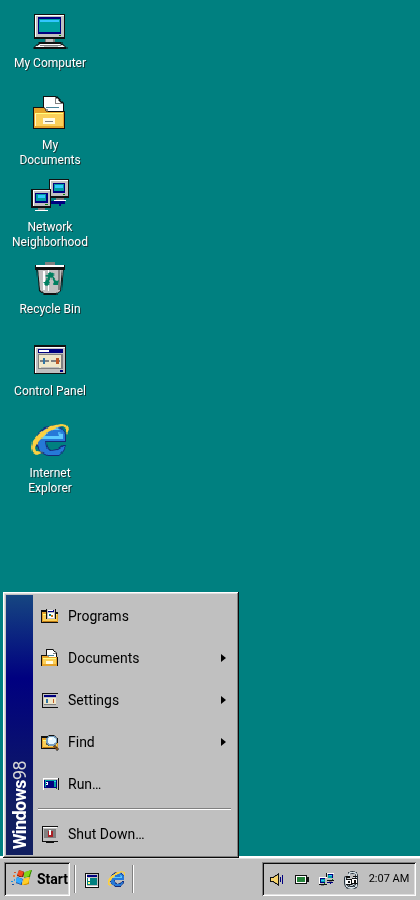
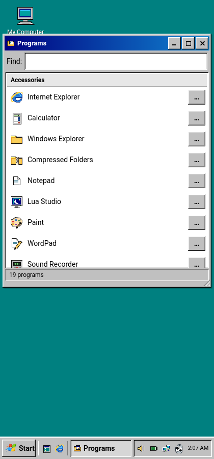
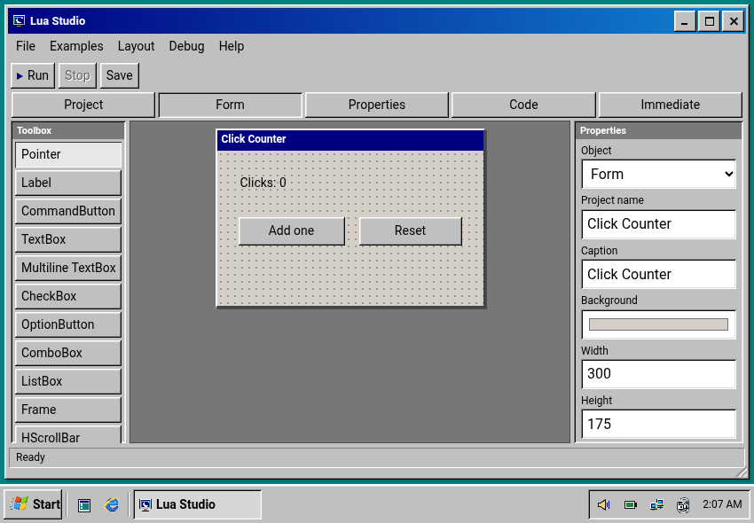
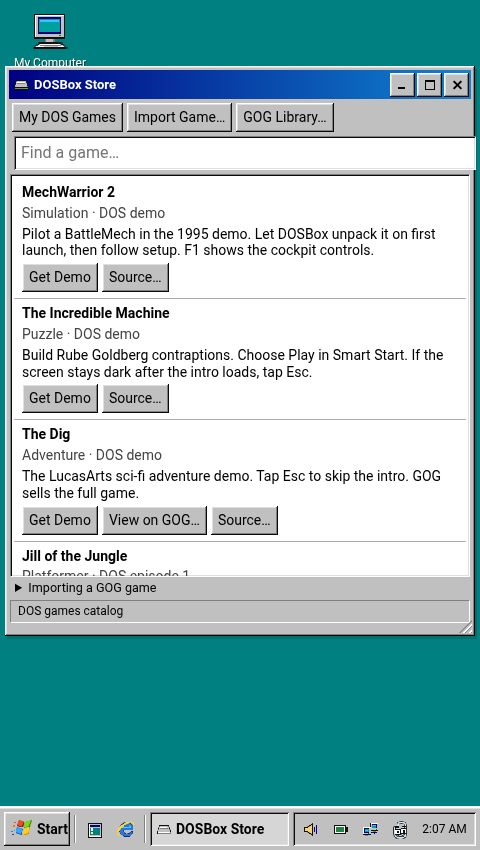
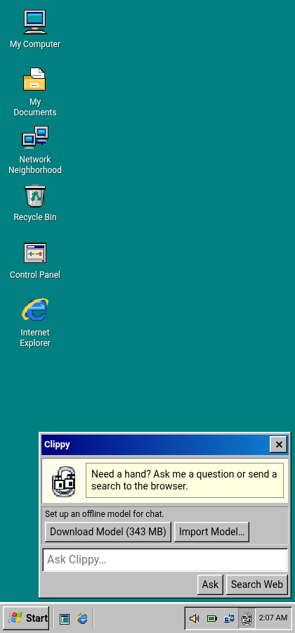
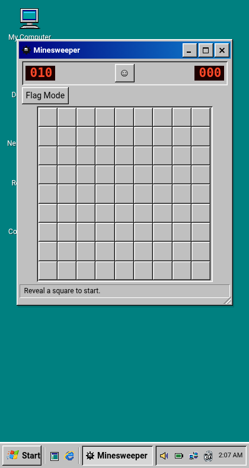
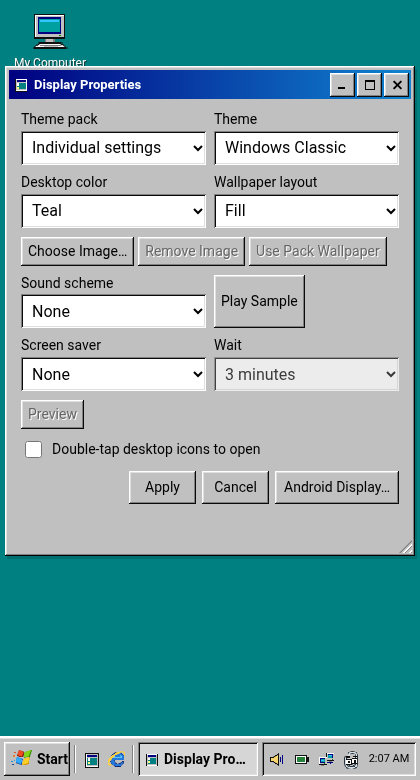

# Retro Desktop 98

### Windows 98 never died. It just learned how to swipe.

**A Windows 98-inspired home launcher for Android.** Real Start menu. Real desktop shortcuts. Resizable windows. A tiny `C:\` drive. A collection of suspiciously useful retro apps. And, because apparently I can't leave well enough alone, DOS games and a pocket-sized Lua IDE.

Built as part of **[Retro Code Ramen](https://retrocodera.men/)** — where we build strange machines, resurrect old ideas, and occasionally ask ourselves whether a project *should* exist several commits after it already does.

> **Status:** Working experimental launcher · **Current source baseline: v2.7** · Android 8.0+ (API 26)  
> **Up next:** v2.8 DOS Gaming Deluxe — fullscreen DOSBox, customizable touch layouts, and per-game controller mapping. Those features are **planned, not shipped**.

---

## A look around the desktop

A few snapshots from inside this tiny beige box. All seven are rendered from the **real v2.7 launcher interface** (HTML, CSS, and JavaScript), at phone-sized viewports. They're **interface previews, not screenshots taken on an Android phone**; the DOSBox Store preview shows the game's built-in catalog, not a live download.

| The desktop, where it all begins | Start → Programs, naturally |
| :---: | :---: |
|  |  |

**Lua Studio:** Drag controls onto a form, double-click an event, and pretend it's 1998 again (except the code is Lua).



| DOSBox Store | Clippy, because of course |
| :---: | :---: |
|  |  |

| Minesweeper: productivity at its finest | Display Properties: make it yours |
| :---: | :---: |
|  |  |

## What is this thing?

Remember when your computer had a personality? When the Start button actually felt like the start of an adventure, every folder was a little mystery, and finding an EXE on a questionable shareware CD was a perfectly reasonable Saturday afternoon?

**Retro Desktop 98 brings a little of that energy to Android.**

It's not a screenshot pretending to be a desktop. It's a real Android **Home app** with a Windows 98-inspired shell. You can make folders, pin shortcuts, change themes, organize files, launch Android apps, and open a growing collection of programs in draggable, resizable desktop windows.

It is **not** a Windows emulator, a replacement for Android itself, or a way to run Windows `.exe` applications. Built-in Retro Desktop programs live inside the launcher; regular Android apps open normally through Android. For old **DOS** games, there's an actual embedded DOSBox engine.

Think **family PC circa 1998**, except it fits in your pocket, doesn't require a beige tower, and hopefully doesn't make the dial-up noise every time you open a browser.

## What's inside the beige box?

| Part of the desktop | What you can do |
| --- | --- |
| **The shell** | Start menu, Programs, desktop shortcuts and folders, Recycle Bin, Quick Launch, taskbar, system tray, Run dialog, recent documents, search, and desktop context menus. |
| **Real desktop windows** | Move, resize, minimize, maximize, and restore the launcher’s built-in apps. Window layouts are remembered separately for portrait and landscape. |
| **My Computer** | Browse a built-in `C:\` workspace, organize files, ZIP and unzip archives, create shortcuts, preview images, and launch files in matching apps. |
| **Display Properties** | Custom wallpapers, classic colors, themes, sound schemes, screen savers, and optional Active Desktop widgets. |
| **Internet Explorer-ish browsing** | Browse sites in a window, download files, and search with **[QuietSeek](https://quietseek.com/)** — the default search engine and homepage. |
| **Classic Accessories** | Notepad, WordPad, Calculator, Paint, Sound Recorder, Character Map, ANSI Viewer, and more. |
| **Multimedia** | **RetroAMP**, a Winamp-style local music player with a playlist, spectrum display, and taskbar Now Playing control. |
| **Communication** | Outlook Express-style IMAP/SMTP mail and HyperTerminal with Telnet, raw TCP, ANSI/CP437, and an offline BBS. |
| **Tinkering** | MS-DOS-style file prompt and **Lua Studio**, a Visual Basic 6-inspired form designer and event-driven Lua IDE. |
| **Games** | Minesweeper, Solitaire, and **DOSBox** running compatible DOS packages *inside* a resizable desktop window. |
| **Clippy** | Taskbar assistant with optional offline AI chat, mail drafting/summaries, and QuietSeek web searches. Yes, that Clippy energy. |

No ads are built into the launcher. The goal is to make your phone feel more like **your computer**, not another billboard with a home screen attached.

## First boot

1. Install a compatible Retro Desktop 98 APK (or [build your own](#building-it-yourself)). Download the [working v2.7 APK from GitHub Releases](https://github.com/RetroCodeRamen/RetroDesktop98-Android/releases/download/v2.7/RetroDesktop98-v2.7.apk).
2. Open **Retro Desktop 98 (Resizable)** and use **Open Settings**, or go to Android **Settings → Apps → Default apps → Home app**.
3. Select **Retro Desktop 98 (Resizable)** as your Home app.
4. Press Home. Look at the teal desktop. Resist the urge to reorganize your entire life into folders. Or don't.

**The desktop is intentionally uncluttered.** All Android apps live under **Start → Programs**. Only the shortcuts you choose are placed on the desktop. Use an app's `…` menu to pin it; moving or deleting a desktop shortcut doesn't uninstall the Android app.

Long-press an empty desktop area for folders and **Display Properties**. Grab a window by its title bar to move it, and drag an edge or the bottom-right corner to resize it. Built-in window arrangements survive a restart.

> **Android reality check:** The launcher opens Android apps through Android. It cannot force arbitrary third-party Android apps to run inside its simulated Windows 98 windows.

## Your own little `C:\` drive

Retro Desktop 98 automatically creates a workspace. There's no setup wizard asking you to pick five folders before you can do anything useful.

```text
C:\
├── My Documents\
├── Downloads\
├── My Pictures\
├── Recordings\
├── Lua Projects\
└── DOS Games\
```

Explorer, WordPad, Paint, Sound Recorder, Lua Studio, downloads, and DOSBox use these folders. Explorer can create more folders, move and copy files, browse ZIPs, and export files to Android storage or the share sheet. The DOS-style command prompt uses the **same** workspace, so you can actually do this:

```bat
C:\> CD "C:\My Documents"
C:\My Documents> DIR
C:\My Documents> TYPE NOTES.TXT
C:\My Documents> EDIT NOTES.TXT
```

It's a **sandboxed virtual drive**, not your Android system partition. Workspace data normally survives app updates, but **uninstalling the launcher removes its app-local files**. Export anything you want to keep before uninstalling. **Desktop Backup** saves desktop configuration; it does *not* back up every workspace file, email account, or downloaded Clippy model.

## DOS gaming, but make it a window

This is where the project went from “cute launcher” to “I have made a small mistake, and it's wonderful.”

**Start → Programs → DOSBox** runs compatible DOS games inside Retro Desktop 98. Import `.zip`, `.dosz`, or `.jsdos` packages into `C:\DOS Games`, launch from the games menu, or pin a game to your desktop. The DOS drive can be saved back to the package's local storage so your in-game saves survive reopening it.

### Sound Blaster? Of course.

The v2.7 DOSBox player includes Sound Blaster 16 emulation, AdLib/OPL3 music, improved Web Audio buffering, a **Test Speaker** control, and a touch D-pad shaped like:

```text
      ↑
   ←  ↓  →
```

The buttons **send arrow keys** (not WASD letters), and holding them keeps the key pressed. Tap the game or **Enable Sound** to start audio on Android. For games with a sound setup program, try:

| DOS sound option | Setting |
| --- | --- |
| Digital sound | Sound Blaster 16 |
| I/O address | `220` |
| IRQ | `7` |
| DMA | `1` |
| High DMA | `5` |
| Music | AdLib / OPL3 or Sound Blaster |

**Tested on a real phone:** *Jill of the Jungle* ran with working music. That doesn't guarantee every game has the same sound setup; some need their own `SETUP.EXE` or `SOUND.EXE` configured.

### DOSBox Store

There's a small in-launcher catalog of downloadable demos and legitimately free releases. It's a **curated download list**, not a store for pirated games.

| Ready-to-download entries | Type |
| --- | --- |
| Jill of the Jungle, Episode 1 | Shareware episode |
| MechWarrior 2 | DOS demo |
| The Incredible Machine | DOS demo |
| The Dig | DOS demo |
| Beneath a Steel Sky | Free DOS edition |
| Tyrian 2.1 | Free DOS release |
| Digger Remastered | Free release |

Other entries, including *Rescue Rover 2 / Dognapped!*, *MechWarrior (1989)*, and *Quarky & Quaysoo's Turbo Science*, point you toward a store or let you import a copy you own.

There's also a **GOG Library** shortcut, but this release does **not** log into GOG or download your purchases automatically. You can import compatible DOS game files from purchases you own. Some GOG editions, including the full *The Dig*, are configured for **ScummVM** instead of DOSBox and may require a different engine.

**Still on the to-do list:** real fullscreen DOSBox, gamepad remapping, customized per-game touch layouts, and better point-and-click mouse controls. See the [roadmap](docs/ROADMAP.md).

## Lua Studio: Visual Basic 6's slightly unhinged cousin

A retro desktop needed somewhere to write weird little programs, so **Lua Studio** happened.

It's a VB6-inspired IDE with a drag-and-drop form designer, Toolbox, Properties panel, event handlers, multiple forms, Lua modules, menu editor, debugger, and compact layout for smaller phones. Build a button, double-click it, write a handler, then **Run** the form in a desktop window.

```lua
function Command1_Click()
  local name = ui.get("Text1", "text")
  ui.set("Label1", "text", "Hello, " .. name .. "!")
end
```

Want your creation to feel like an actual desktop app? Use **File → Add to Programs…** to publish it under **Start → Programs → Lua Programs**, then pin it like any other app. Projects can be exported as portable ZIPs.

It's **Lua, not Visual Basic**: no VB6 `.vbp` compatibility, Windows COM/ActiveX, compiled EXEs, or standalone Android APK export. The Lua runtime is isolated from direct device-file, network, system, and Java access. See the [full feature guide](docs/USER_GUIDE.md#lua-studio) for the editor and debugging tools.

## Clippy has entered the chat

Tap the paperclip next to the taskbar clock. Clippy can open searches in **QuietSeek** immediately, and an **optional ~343 MB Qwen3 0.6B model** adds offline chat on compatible devices. You can also import a compatible `.litertlm` model.

In Outlook Express, Clippy can summarize a selected message or **draft a reply**. The reply stays editable, and **you** decide whether to send it. No surprise emails from a sentient paperclip. We have standards.

The model is not bundled in the base APK. Offline inference speed depends on your phone, and it is not a substitute for checking important answers.

## A few more oddities worth opening

- **HyperTerminal** — Telnet, raw TCP, ANSI color/CP437, saved connections, and a built-in offline BBS. The network transports are **unencrypted**, so use them only with services where that's appropriate.
- **RetroAMP** — playlists, repeat modes, position controls, spectrum bars, and music that continues while you use other launcher windows.
- **Outlook Express** — one IMAP/SMTP account, plain-text reading/sending, and attachments. Some providers require app passwords; OAuth2-only providers are not supported by this build.
- **Active Desktop** — optional QuietSeek search, Scratch Note, and Now Playing widgets, because the late '90s were not known for restraint.
- **Display Properties** — Classic, Science Fiction, and Underwater theme packs, plus your own wallpaper.

For the deep-dive, keyboard shortcuts, program-specific setup, and complete feature inventory, see the **[User Guide](docs/USER_GUIDE.md)**.

## Building it yourself

You'll need **JDK 17+**, **Android SDK Platform 35**, and **Build-Tools 35.0.1**. The project includes a Bash build script that downloads pinned build dependencies. Android Studio / Gradle builds are also described in the [User Guide](docs/USER_GUIDE.md#build-from-source).

```bash
export ANDROID_HOME=/path/to/android-sdk
./build-apk.sh

# Source and package checks
node tests/dosbox-audio.test.js
python3 tests/check_apk_package.py build/RetroDesktop98.apk
```

Output: `build/RetroDesktop98.apk`.

**Very important, courtesy of an actual debugging adventure:** Correct signing alone does not mean Android will install an APK. The final package must have **4-byte-aligned `resources.arsc`** and **16 KiB-aligned native libraries**. Earlier v2.7 APKs failed installation because the resource alignment was wrong. The build script runs the packaging check, and release candidates should still be install-tested on real Android hardware.

The script can generate a **local development signing key**. That APK **cannot update** an installation signed with a different key. Never commit the release keystore or its password. See [Security & Releases](docs/SECURITY_AND_RELEASES.md) and the [v2.7 install repair notes](INSTALL_REPAIR.md).

> **CI status:** GitHub Actions currently runs **source checks**, not a verified signed APK release pipeline. Automated distribution is a future task. Check [Actions](https://github.com/RetroCodeRamen/RetroDesktop98-Android/actions) to see the checks rather than assuming an APK is already available there.

## What's cooking next?

The current [roadmap](docs/ROADMAP.md) puts **DOS Gaming Deluxe** next:

- True fullscreen DOSBox with a reliable return to the desktop.
- Bluetooth/USB gamepad mappings saved per game.
- Movable, customizable touchscreen controls.
- Virtual mouse and point-and-click quality-of-life improvements.
- Per-game display, CPU, and Sound Blaster settings.

Longer term? More weird little utilities, more shareware-era charm, and fewer reasons to leave the desktop. The only real rule is that it should be **fun to use**, not just fun to look at.

## Credits, rights & the boring-but-important bits

Retro Desktop 98 is an independent **Retro Code Ramen** project, inspired by the Windows 98 era. It is **not affiliated with or endorsed by Microsoft**, and it does not include Microsoft's operating system.

The project includes third-party DOSBox/WebAssembly, Lua, mail, and LiteRT components. Their respective notices and source information live in `vendor-source/` and the bundled `*-notices.txt` files. Check the individual redistribution terms before making public releases. **No project-wide license has been declared in this repository yet**; don't assume the entire source tree is unrestricted for reuse.

The DOSBox Store links to third-party downloads; game ownership and redistribution rights remain with their respective creators and publishers. Commercial games are not bundled with the launcher.

Found a bug? Got a strange idea? Open an issue (if you have repository access) and include the app version, Android version, and a short reproduction. Especially if something only breaks on a tiny screen. Those are the fun ones.

---

**Retro Code Ramen** · Indie projects. Retro tech. Creative chaos.  
*Boot up. Click around. Stay weird.*